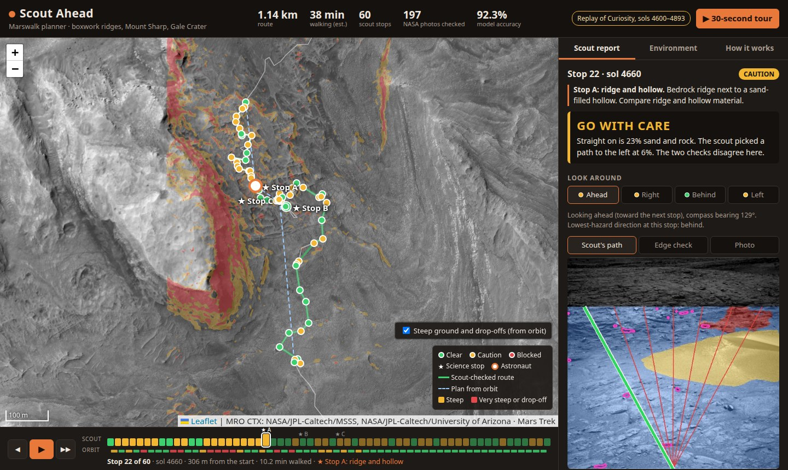
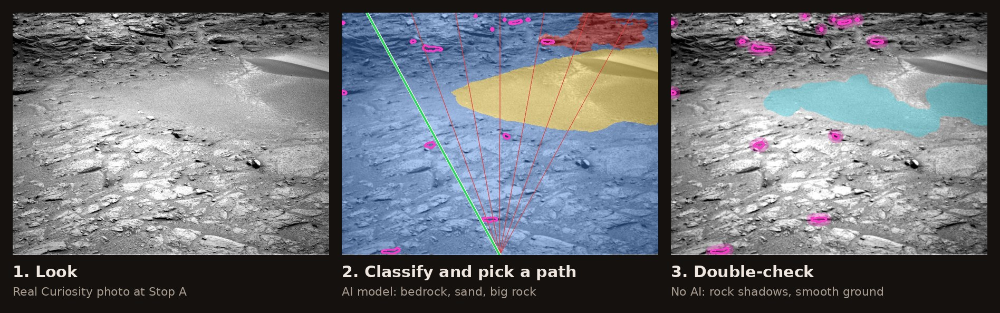
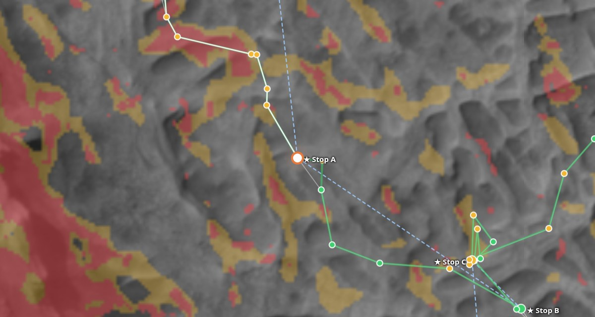

# Scout Ahead

**Know the ground before you walk.** A Marswalk planner for the boxwork ridges of Mount Sharp, Gale Crater. A robotic scout checks the ground ahead of the astronaut and pins what it finds on the map.

[**Live demo**](https://lorenzodemarni.github.io/mars-scout/) · [**30-second video**](https://lorenzodemarni.github.io/mars-scout/demo.mp4) · NASA Space Apps Challenge 2026, "Interplanetary Survival Guide: Martian Map"

[](https://lorenzodemarni.github.io/mars-scout/)

> The scout is a replay of a real Curiosity drive (sols 4600–4893, 2025–2026). It is not a live feed.

## How it works



1. **Plan from orbit.** NASA's 1 m HiRISE elevation model marks steep ground and drop-offs around the walk, and rates every leg of the route.
2. **Send a scout.** At each of 60 rover stops the scout looks at up to four navigation camera photos: ahead, right, behind and left.
3. **Check the ground twice.** A segmentation model trained on NASA's AI4Mars labels classifies each photo into soil, bedrock, sand and big rock. A separate edge check with no machine learning finds rock shadows and smooth ground. If the two disagree, the stop is never marked clear.
4. **Pick a path.** Seven candidate paths are scored in each photo by the share of sand and rock they cross. The safest is drawn in green and the others in red.
5. **Brief the astronaut.** Each stop shows a go / go with care / no go verdict, the time to walk back, the weather Curiosity measured on that sol, slope, and radiation dose so far.



## Results

| | |
|---|---|
| Route | 1.14 km, about 38 minutes at 0.5 m/s |
| Scout stops | 60 (23 clear, 37 go with care) |
| Photos analysed | 197 |
| Model pixel accuracy | 92.3% on the AI4Mars expert test set (`test_min1`, 322 images) |
| Model mean IoU | 0.67 (soil 0.91, bedrock 0.81, sand 0.86, big rock 0.11) |
| Orbital elevation vs Curiosity's own | within 0.4 m at all 60 stops |

## NASA data used

| Data | Source |
|---|---|
| Terrain labels for training and testing | [AI4Mars](https://data.nasa.gov/dataset/ai4mars-a-dataset-for-terrain-aware-autonomous-driving-on-mars) (NASA JPL), via the Hugging Face mirror [`hassanjbara/AI4MARS`](https://huggingface.co/datasets/hassanjbara/AI4MARS) |
| Rover stops | [Curiosity waypoints](https://mars.nasa.gov/mmgis-maps/MSL/Layers/json/MSL_waypoints.json) (NASA/JPL-Caltech) |
| Scout photos | [Curiosity raw images](https://mars.nasa.gov/msl/multimedia/raw-images/), left navigation camera |
| Basemap | MRO HiRISE and CTX mosaics of Gale Crater, tiles from [Mars Trek](https://trek.nasa.gov/mars/) |
| Elevation | [MSL Gale merged DEM, 1 m](https://astrogeology.usgs.gov/search/map/mars_msl_gale_merged_dem_1m_v3), from MRO HiRISE stereo (USGS Astrogeology) |
| Weather | Curiosity REMS, from the [`mars.nasa.gov` weather feed](https://mars.nasa.gov/rss/api/?feed=weather&category=msl&feedtype=json) |
| Radiation | Curiosity RAD surface average (Hassler et al., Science, 2014) |

## Limits

- The scout is a replay. Photos, positions and weather are Curiosity's, recorded in 2025–2026.
- Terrain labels are model predictions. The model misses most big rocks (IoU 0.11), which is why the edge check runs alongside it.
- The edge check has not been scored against labels. It can mistake a shadowed bedrock step for a rock.
- Path picking is 2D, in the photo. There is no depth or 3D, and the chosen path is not placed on the map; the re-route bend on the map is illustrative.
- Walking speed (0.5 m/s) and the slope limits (15° caution, 25° avoid) are our assumptions, not NASA limits.
- Slope from orbit agrees only moderately with rover tilt on the ground (correlation 0.41), so it is a guide to steep areas, not an exact value.
- Radiation is a long-term average from Curiosity RAD (0.67 mSv/day), not a live reading. There are no solar storm alerts.
- NASA's weather feed contains a few suspicious readings. They are shown as published, with a note.

## Repository layout

| Path | Contents |
|---|---|
| `model/` | Prepare AI4Mars, train and evaluate the terrain model |
| `scout/` | Download the drive, run the scout, build the route and terrain hazards |
| `docs/` | The static map page served by GitHub Pages |
| `docs/data/` | JSON and images the page reads, all generated by `scout/` |

## Run it yourself

Needs [uv](https://docs.astral.sh/uv/), Python 3.12 and a GPU with about 8 GB of memory for training.

```bash
uv sync

# 1. Model (about 35 minutes on an RTX 2070 SUPER)
uv run hf download hassanjbara/AI4MARS --repo-type dataset --local-dir data/ai4mars
uv run python model/prepare_data.py
uv run python model/train.py
uv run python model/evaluate.py
cp checkpoints/test_results.json docs/data/model.json

# 2. Scout
uv run python scout/fetch_drive.py      # photos and stops from NASA
uv run python scout/run_scout.py        # model + edge check + path picking
uv run python scout/build_route.py      # route, weather, radiation
uv run python scout/fetch_dem.py        # elevation window from the HiRISE DEM
uv run python scout/terrain_hazards.py  # slope and drop-off overlay

# 3. View
python3 -m http.server 8765 --directory docs
```

Built with Python, PyTorch, segmentation-models-pytorch, OpenCV, rasterio and Leaflet.

## AI use

This project was built with AI coding assistance, under the author's direction. No AI-generated images are used: every photo is NASA's.
